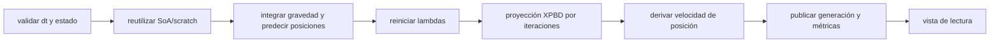

# Especificación de arquitectura del MVP

## Resumen ejecutivo

Se selecciona **XPBD** por ser el supuesto indicado cuando el dominio no está definido. El MVP es un solver CPU escalar de constraints de distancia para partículas, publicado como biblioteca C11/C++20. XPBD permite controlar elasticidad con compliance y tolera substeps, evitando resolver simultáneamente fluidos SPH o fractura voxelizada. El núcleo actual es monohilo y de capacidad fija; es una base verificable, no una promesa de rendimiento ni compatibilidad de producción.

SPH se descartó para el MVP por su dependencia de vecindad, ajuste de presión y explosión de vecinos; fractura voxelizada por conectividad, memoria y generación de fragmentos. XPBD necesita menos estado y tiene validación analítica directa. Pendientes: constraints adicionales, scheduler host, allocator personalizado, SIMD y validación legal de la marca.

## ADR

| Decisión | Alternativas | Razón |
|---|---|---|
| XPBD de distancia | SPH, fractura | Menor superficie de MVP y compliance estable |
| `float` interno | `double` | Menor ancho de banda; tolerancias explícitas |
| SoA lógico | AoS | Kernels leen campos homogéneos; mejor vectorización futura |
| capacidades fijas | crecimiento en step | Ausencia de asignaciones en hot loop |
| ABI C11 opaca | ABI C++ | FFI y estabilidad de símbolos |
| CPU escalar | GPU/SIMD obligatorio | referencia determinista y portable primero |

## Capas y pipeline

Cada substep integra `v += g h`, predice `x += v h`, reconstruye la grid uniforme 3D, resetea lambdas de distancia, proyecta constraints y contactos, y reconstruye `v=(x-x_prev)/h`. La respuesta de restitución/fricción y el suelo se aplican después. En una versión paralela cada nodo es una barrera: integración paralela, coloración de constraints o acumuladores por worker/reducción, y publicación posterior a la última barrera.

Estados observables: creado/ready, `view_held` (readable y bloqueado para escritura), y destruido. `dq_step` y mutaciones durante vista devuelven `DQ_BUSY`. Errores de argumento no cambian estado. La ejecución serial es reproducible para el mismo compilador/plataforma y datos; no se promete igualdad bit a bit entre arquitecturas o futuras reducciones paralelas.

## Memoria y estructura espacial

El estado activo es SoA: `pos_x/y/z[N]`, `prev_x/y/z[N]`, `vel_x/y/z[N]`, `inverse_mass[N]` y `constraints[C]={a,b,rest,compliance,lambda}`. Cada array se reserva a capacidad fija y el hot loop sólo accede a componentes escalares. La ABI conserva `dq_vec3` en una pareja de buffers de publicación AoS preasignados: se rellenan al adquirir una vista, nunca durante `dq_step`. La alineación base de 64 bytes queda para una arena allocator-aware posterior; no implica vectorización. Para `N` partículas y `C` constraints el presupuesto aproximado es `52N + 20C` bytes, más buffers de publicación `48N`, capacidad de vector y allocator. Las vistas se invalidan sólo tras `release` y posterior mutación/step; no hay punteros persistentes.

La estructura espacial es una **uniform grid compacta 3D**: entradas contiguas `(x,y,z,index)` pre-reservadas y ordenadas después de la predicción. Tiene coste O(N log N) con sort general (u O(N) radix), buena localidad y consultas de 27 celdas. Para garantizar cobertura, el contrato exige `grid_cell_size >= 2 * particle_radius`; un spatial hash evita mundo enorme pero dispersa caché, y LBVH u octree lineal no justifican su complejidad para radio homogéneo XPBD. La grid protege la conversión de coordenadas mediante clamp a `int32_t`, acepta escena vacía y el solver aplica proyección XPBD, contactos persistentes, restitución y fricción.

## Invariantes y pruebas de referencia

Con dos partículas, una fija en 0 y una libre a 2 m, `L=1`, compliance 0 y sin gravedad, una iteración aplica `Δλ=-1` y deja la libre en 1 m. El test automatizado exige error menor que `1e-4`. Con gravedad cero y velocidad cero, una partícula sin constraints conserva posición y velocidad. La suite también cubre capacidad, suelo, contacto y un contacto puramente en Z. Para compliance no nula se contrastará la elongación con la ecuación XPBD y tolerancia `1e-4 + 1e-5|valor|`. NaN/Inf, índices inválidos y `dt<=0` se rechazan.

## ABI, ownership y FFI

`physics.h` es C11 autocontenida, con handles opacos, `dq_result`, versión empaquetada y símbolos `dq_`. La versión 0.x mantiene compatibilidad de fuente dentro de minor y no promete ABI estable hasta 1.0; desde 1.0 los cambios ABI requieren major. Ingesta siempre copia campos al contexto. `dq_context_destroy` no debe concurrir con llamadas ni vista retenida. `dq_context_last_error` informa tamaño requerido y no usa estado global. El callback allocator declara tamaño/alineación y simetría, pero está explícitamente sin implementar en este MVP.

| Función | Precondición | Resultado/propiedad | Errores |
|---|---|---|---|
| `dq_context_create` | descriptor versionado válido | contexto del llamador | argumento, OOM, backend |
| `add_particle` | datos finitos, sin vista | copia un particle | capacidad, busy |
| `add_distance_constraint` | IDs válidos | copia constraint | argumento, capacidad, busy |
| `dq_step` | `dt` finito positivo, sin vista | avanza estado | argumento, busy |
| `particles_acquire/release` | handle válido/generación igual | snapshot AoS const preasignado | busy, estado |

El primer binding previsto es Rust: `NonNull<dq_context>` en RAII `Drop`, APIs que toman `&mut self` para impedir `step` con vista viva, y vista con lifetime. `Send/Sync` no se implementará hasta definir sincronización. C# usará `SafeHandle` y pinning sólo para entrada futura; Python preferirá `cffi` y copia segura a NumPy tras release.

## SIMD, GPU e integraciones

La referencia escalar debe pasar antes de auto-vectorización o intrínsecos. Fase 2 separará componentes, usará tails escalares y variantes AVX2/AVX-512/NEON seleccionadas en runtime, siempre con fallback. `fast-math` queda desactivado. GPU queda fuera de la ABI: un backend futuro tendrá staging explícito, sin prometer zero-copy.

Godot debe ser un GDExtension fino que copia/sincroniza en el tick de física; Unreal, un módulo que respeta substepping y el hilo de simulación. Un host in-house llama la C ABI desde su scheduler. Todos deben convertir unidades, handedness y ejes fuera del núcleo, y no leer una vista mientras se simula.

## Validación, benchmark y roadmap

Tests actuales: distancia rígida, `dt=0`, conservación simple, capacidad, suelo, contactos y cobertura en Z. Pendientes: propiedades, estrés de capacidad, ABI C en CI, TSan, fuzz de descriptores y cross-platform. ASan/UBSan se pueden activar y enlazan también los consumidores de la biblioteca estática. Benchmark pendiente de medición: escenarios N=1k/10k/100k, varios C/N, substeps; registrar mediana/p95/p99 de ms/step, RSS, bytes/entidad, instrucciones, misses y escalado. `perf` mide contadores hardware; Cachegrind sólo simula cachés.

1. **Fase 1 (S):** referencia actual, tests de invariantes y escenas deterministas. Gate: tests matemáticos y entradas adversarias.
2. **Fase 2 (M):** SoA estricto, arena alineada, grid y perfil. Gate: sin asignaciones en step y equivalencia numérica.
3. **Fase 3 (M):** scheduler host, coloración, ABI y ejemplo C. Gate: TSAN limpio en configuración compatible.
4. **Fase 4 (L):** CI, sanitizers, benchmark y binding Rust. Gate: resultados reproducibles documentados.

Backlog prioritario: (1) instalar CI CMake; (2) allocator-aware storage; (3) scratch arena; (4) constraints bending; (5) scheduler; (6) coloración; (7) SIMD; (8) Rust binding; (9) fuzz; (10) benchmark CSV; (11) revisar licencia/marca.

## Trazabilidad y riesgos

| Requisito | Componente | Prueba | Fase |
|---|---|---|---|
| ABI C11 | `physics.h` | compilar ejemplo C | 1/3 |
| no allocations hot loop | reserve de contexto | profiler/contador | 2 |
| corrección XPBD | solver | distancia analítica | 1 |
| snapshot de lectura seguro | acquire/release | busy/generación | 1 |
| portabilidad | CMake | CI multi-OS | 4 |

Riesgos: divergencia float/SIMD (tolerancias), explosión de vecinos (el radio de consulta actual se limita por contrato a una celda), carreras (barreras/coloring), ABI breakage (versionado), crecimiento de capacidad (errores recuperables) e invalidación de vistas (pin/release). Los contactos partícula-partícula usan una caché pre-reservada con lambda XPBD y purga de entradas no vistas tras cuatro pasos; si se agota la capacidad, el paso no asigna memoria y expone los contactos descartados en `dq_stats`. `assets/branding/` se reserva para branding separado: el núcleo no depende de esos recursos.
